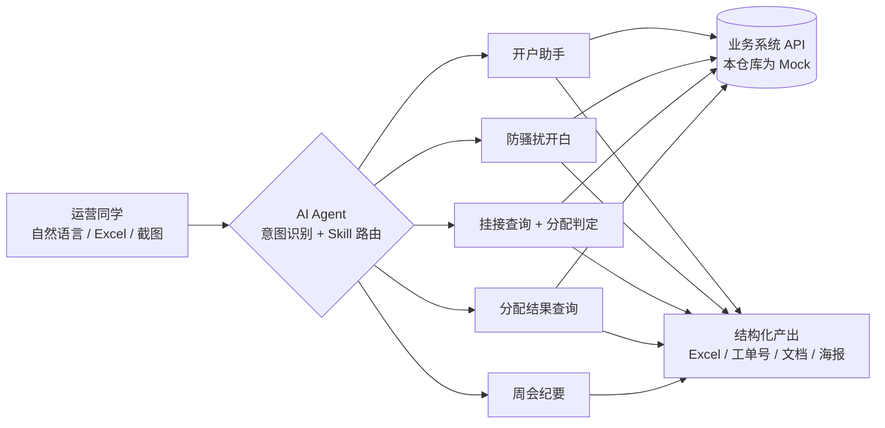

# AI Agent Ops Toolkit · 渠道服务商运营自动化工具集

> 基于 AI Agent + Skill 架构，把渠道服务商运营里**高频、重复、规则明确**的工作交给 Agent 自动完成：开户提报、防骚扰开白、自助户挂接查询与分配判定、分配结果追踪、周会纪要等。
>
> ⚠️ 本仓库是实习项目的**脱敏重构版**：保留思路、架构和判定逻辑；所有账号、服务商、接口均用虚构数据和 Mock 代替，不含任何公司内部数据或接口。

  

---

## 📌 项目背景

我在实习期间负责渠道服务商运营，对接 12 家服务商，日常主要处理三条链路：

| 链路 | 日常工作 | 人工处理的痛点 |
|---|---|---|
| **特殊开户** | 生态双挂、一户多开、自投转代投等开户提报 | 前置条件多（投放账户是否开通、邮箱是否被占用、端口是否选对），漏查一项就会被驳回 |
| **客资治理** | 为被同行或灰产骚扰的广告主提报防骚扰开白工单 | 一批十几条，每条都要上传截图、填表、建单、回查挂接 |
| **自助户分配** | 查广告主挂接关系，判断能否分配给服务商 | 一批几十个 UID，要逐个查 CRM 再套规则，规则又有很多例外 |

这些工作有个共同点：**规则明确、重复度高、出错代价大**，很适合交给 Agent。

## 💡 解决方案

用 **AI Agent 作为调度层**，每类业务封装成一个独立的 **Skill**（说明文档 + 脚本）。用户用自然语言发需求，Agent 自动匹配对应的 Skill 并执行，最后返回结构化结果（Excel、工单号、下载链接）。



详细架构见 [docs/architecture.md](docs/architecture.md)。

## 🧩 核心功能

### 1. 开户助手 —— 提报前自动排雷
- 支持 **5 类**特殊开户：生态双挂、一户多开、自投转代投、自投转代投专项、服务自助户挂服务商专项
- 提报前自动检查：投放账户是否开通、子账号邮箱是否被占用、子账号名称是否重复、走账 / 非走账端口是否选对
- 需要截图的类型会自动上传附件，提交后返回申请 ID
- 先按「开户类型选择矩阵」判断该走哪种类型，避免类型选错被拒

### 2. 防骚扰开白 —— Excel 进，工单出
- 直接读取提报 Excel，**解析单元格里嵌入的截图**（WPS 的 DISPIMG 格式）
- 批量上传截图、建单，并同步回填每个广告主的 CRM 挂接信息
- 导出带工单链接的结果表
- 配合 **「强 / 中 / 弱」三级证据分级**，提前识别证据偏弱、可能被驳回的单子

### 3. 自助户挂接查询 + 分配判定 —— 一键出结论
- 批量查询行业、销售、运营、部门归属、代理商，并自动校验 UID 格式
- **二次开发的分配判定模块**：把线索线和消费品线两套规则写成代码，直接输出「是 / 否 / 待人工确认」和原因
- 判定模块独立开关（`--alloc`），**不改动原有查询逻辑**
- 👉 可运行示例：[`src/allocation.py`](src/allocation.py)，规则说明：[docs/allocation-rules.md](docs/allocation-rules.md)

### 4. 分配结果查询（独立设计的 Skill）
- 输入 UID，**同时查**线索和消费品两张分配表，命中哪张就属于哪条线
- 原流程是 4 步（先查行业 → 选表 → 查表 → 读备注），简化为 **2 步**
- 返回分配备注、所属服务商、处理人，省去二次对账

### 5. 周会纪要
- 把会议转写稿（单期约 5.5 万字）整理为**精简文字稿 + 可视化海报**两份产出
- 固定「结论 → 数据 → 待办」结构，突出业务结论和负责人

### 6. 流程沉淀
- **服务商提报协助表**：整合 10+ 类提报事项，按「产品文档 → 服务商填报 → 渠道提报」三栏协作
- **开户自查 SOP**：梳理 7 种开户场景，做成决策流程图和在线自查工具，见 [docs/开户自查SOP.md](docs/开户自查SOP.md)

## 📊 效果数据

| 指标 | 结果 |
|---|---|
| CRM 特殊开户提报 | **200+ 笔** |
| 防骚扰开白工单 | **300+ 单** |
| 自助户 UID 批量查询 | **2000+ 个** |
| 分配结果查询流程 | **4 步 → 2 步** |
| 周会纪要 | **10+ 期** |
| 借助工具定位的系统问题 | **2 个**（见下方） |

## 🔍 数据洞察：工具顺带发现的系统问题

工具跑多了，就能把以前零散的失败案例放在一起看。我对分配表做了全表扫描，把分配失败归成三类：

| 类型 | 含义 | 发现 |
|---|---|---|
| **余额类** | 客户余额不满足代投门槛 | 申请表写的余额门槛和系统实际门槛**不一致**，影响 **30+ 条记录、7 家服务商** |
| **归属类** | 客户已有服务商 | 多为提报前没核查客户归属，属于操作问题 |
| **系统错误类** | 服务商在分配系统中登记缺失等 | 两套系统的服务商 ID 不一致：CRM 里能拦截，分配系统里却分不下去，**导致客户流失** |

两个系统问题我都整理了证据文档并上报，推动修复。完整分析见 [docs/case-study.md](docs/case-study.md)。

## 🚀 快速体验

```bash
git clone https://github.com/liancirong-maker/ai-agent-ops-toolkit.git
cd ai-agent-ops-toolkit
pip install -r requirements.txt

# 用虚构数据跑一次批量分配判定，结果输出到 output/
python src/batch_lookup_demo.py --input sample_data/demo_accounts.csv --alloc

# 运行单元测试
python -m pytest tests/ -v
```

示例输出：

```
a1b2c3d4e5f6a7b8c9d0e1f2  示例花艺工作室   线索    是
b2c3d4e5f6a7b8c9d0e1f2a3  示例婚纱摄影     线索    否  已挂接自家服务商：服务商A
c3d4e5f6a7b8c9d0e1f2a3b4  示例连锁家居     线索    否  KA 客户
d4e5f6a7b8c9d0e1f2a3b4c5  示例民宿         线索    否  仅挂接销售
e5f6a7b8c9d0e1f2a3b4c5d6  示例旅拍         —      —  部门归属为空，需人工确认
a7b8c9d0e1f2a3b4c5d6e7f8  示例零食铺       消费品  否  纯新客（无挂接且 120/180 天无消耗）
b8c9d0e1f2a3b4c5d6e7f8a9  示例母婴店       消费品  是
12345678                  示例格式异常账号 —      —  UID 格式异常，应为 24 位十六进制
...
共 10 个：可分配 3 / 不可分配 4 / 待确认 3
```

## 📁 目录结构

```
ai-agent-ops-toolkit/
├── README.md
├── docs/
│   ├── architecture.md        # Agent + Skill 架构
│   ├── skills-overview.md     # 全部 Skill 清单与职责
│   ├── allocation-rules.md    # 分配判定规则（脱敏）
│   ├── case-study.md          # 分配失败数据洞察
│   ├── 开户自查SOP.md          # 7 种开户场景决策流程
│   └── meeting-notes-workflow.md
├── src/
│   ├── allocation.py          # 分配判定模块（可运行）
│   ├── batch_lookup_demo.py   # 批量查询 + 导出示例
│   └── mock_crm.py            # Mock 数据源
├── sample_data/
│   └── demo_accounts.csv      # 虚构账号数据
└── tests/
    └── test_allocation.py     # 单元测试 + 名单回归测试
```

## 🧠 踩过的坑与反思

1. **名单回归测试不能自己证明自己**：录服务商名单时有两个错字，回归测试也用同一份字符串，所以测试全部通过，错误却没暴露。后来改成用**系统真实返回的名称**做正反两向测试（名单内的必须全部命中，名单外的必须全部排除），才把问题找出来。
2. **新功能独立接入，不破坏原有逻辑**：分配判定做成独立模块和独立开关，不加开关时输出和原来完全一致，方便调试和回滚。
3. **规则会有例外，要先设计好「待人工确认」**：比如部门归属为空、跨部门挂接这类情况，系统不强行给结论，而是输出「待确认 + 原因」交给人判断。
4. **看数据时注意幸存者偏差**：只看失败记录，会高估某家服务商的问题；拉全量数据后，才发现真正的问题是积压未处理。

## 🛠 技术栈

`AI Agent（OpenClaw）` · `Skill 架构（SKILL.md + 脚本）` · `Python` · `Node.js` · `pandas / openpyxl` · `REST API` · `Mermaid`

## 📄 License

MIT · 仅供学习交流，示例数据均为虚构。
