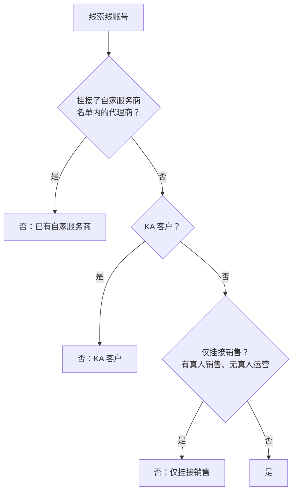

# 自助户分配判定规则（脱敏版）

> 服务商名称、部门名称已替换为通用描述，判定逻辑与实际使用的版本一致。

## 一、输出取值

| 分配结果 | 含义 | 说明列 |
|---|---|---|
| **是** | 可分配 | 留空 |
| **否** | 不可分配 | 写明拦截原因 |
| **空** | 无法判断，需人工确认 | 写明原因 |

## 二、先判断属于哪条线

按挂接人员所在的部门判定「线索线」或「消费品线」。销售和运营不在同一条线时，**以运营为准**；两者部门都为空时，输出「空」，交给人工确认。

## 三、线索线：命中任一条即「否」

- **自家服务商**只看名单内的 12 家；名单外的代理商不拦截
- **KA** 按销售所在部门判定；「虚拟挂接池」类部门不算 KA
- **仅挂接销售**的前提是销售必须是真人挂接；运营挂在虚拟池里，视为运营无挂接
- ⚠️ 销售和运营**都没有挂接**时，不算「仅挂接销售」→ 可分配

## 四、消费品线：按优先级依次判断

| 顺序 | 条件 | 结果 |
|---|---|---|
| ① | 挂接了自家服务商 | 否 |
| ② | 运营挂在虚拟挂接池 | 是（不看消耗） |
| ③ | 纯新客：销售和运营都没有挂接，且 120 天、180 天内都没有消耗 | 否 |
| ④ | 其余情况 | 是 |

> 第 ② 条是后来修复的漏洞：之前运营挂在虚拟池的账号会被当成「没有运营」，一旦同时没有消耗，就会误判为纯新客。修复时我把历史判「否」的账号逐个回溯了一遍，确认没有受影响的记录。

## 五、名单回归测试规范

**错误做法**：录入名单的人用同一份手写字符串测试 → 测试一定全部通过，错别字也不会暴露。

**正确做法**：用**系统真实返回的名称**做正反两向测试。
- 正向：名单内的每一家都必须命中
- 反向：名单外的代理商都必须排除

对应代码见 `tests/test_allocation.py::test_provider_list_regression`。
