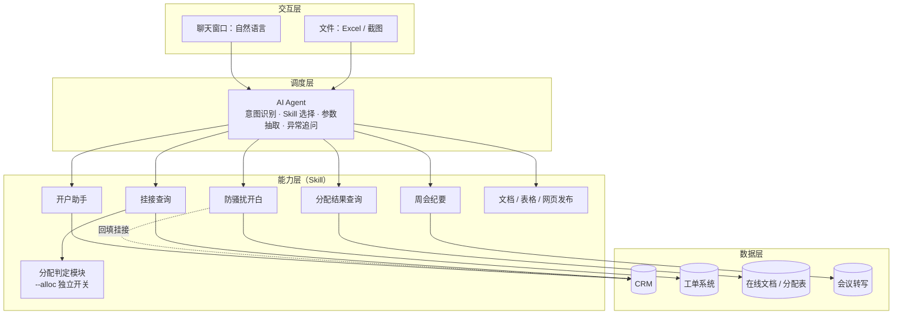
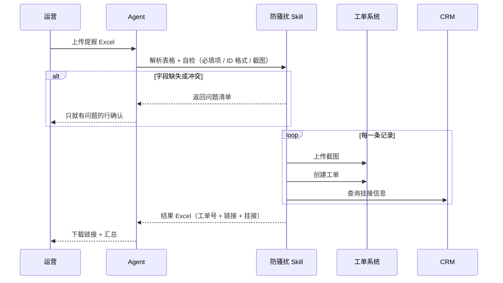

# 架构设计

## 一、为什么用「Agent + Skill」而不是写一个大脚本

| 方案 | 问题 |
|---|---|
| 一个大脚本处理所有业务 | 改一处可能影响全部；业务同学不会改代码 |
| 每个业务一个独立脚本 | 要记住哪个脚本、怎么传参，学习成本高 |
| **Agent + Skill（本项目）** | 每个 Skill 独立维护；用户只说自然语言，由 Agent 负责路由和传参 |

## 二、分层结构



## 三、一个 Skill 由什么组成

```
skill-name/
├── SKILL.md      # 给 Agent 看的说明书：什么时候触发、流程、规则、注意事项
└── scripts/      # 确定性逻辑：API 调用、规则判定、Excel 读写
```

**设计原则：**
- **能写成规则的交给代码，需要理解的交给 Agent。** 分配判定、字段校验写在脚本里，结果稳定可测；读截图、理解用户意图、处理例外交给 Agent。
- **只在必要时停下来问人。** 字段缺失、截图缺失、信息冲突时才打断确认，其余情况直接执行。
- **结果可追溯。** 每笔操作都返回申请 ID 或工单号，并导出结果表。

## 四、典型执行流程：防骚扰批量提报


