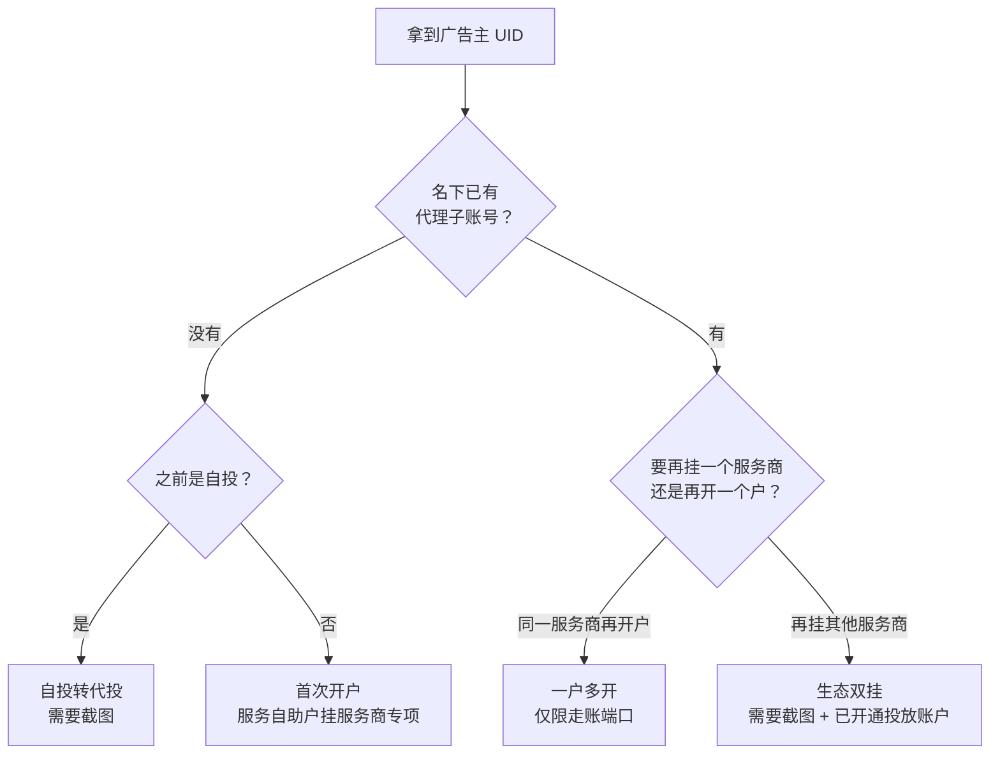

# 开户自查 SOP

## 一、适用场景

服务商要帮广告主开代理子账号，但不确定该走哪种开户类型、需要准备哪些材料。

## 二、前置信息

广告主 UID、代理商、端口类型（走账 / 非走账）、子账号名称、子账号邮箱，以及审批截图（部分类型需要）。

## 三、决策流程

## 四、提报前检查清单

- [ ] 投放账户是否已开通（生态双挂必须满足；需要客户自己去后台开通）
- [ ] 子账号邮箱是否被占用
- [ ] 子账号名称是否重复
- [ ] 走账 / 非走账端口是否选对
- [ ] 截图里的代理商名称、诉求类型与本次提报是否一致

## 五、常见坑

| 现象 | 原因 | 处理 |
|---|---|---|
| 报「暂无有效代理商子账号，不支持一户多开」 | 名下没有任何代理子账号 | 改走首次开户 |
| 报「已存在有效的代子」 | 生态双挂要求名下没有有效代理子账号 | 改走一户多开，或核实需求 |
| 报「未开通投放账户」 | 客户还没开通投放账户 | 通知客户自己开通 |
| 纯新客也开不下来 | 主体被客保锁定，或行业 / 地区受限 | 需要走客保释放流程，同步 leader |

## 六、产出

申请 ID（格式：前缀 + 日期 + 序号），等审批通过后在子账户列表里核对。
